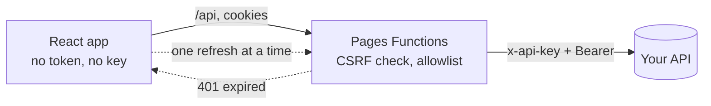

<!-- @template:only:start -->
# template-react-bff-cloudflare

[](https://github.com/HenriqueVon/template-react-bff-cloudflare/actions/workflows/deploy.yml)
[](https://github.com/HenriqueVon/template-react-bff-cloudflare/actions/workflows/template-init.yml)
[](https://github.com/HenriqueVon/template-react-bff-cloudflare/actions/workflows/codeql.yml)
[](LICENSE)

A production-minded starting point for web apps that sign users in and talk to an API: **React 19**, TypeScript, Vite, Tailwind and TanStack Query in the browser, and a **backend for the frontend on Cloudflare Pages Functions** that keeps every token out of the page. Create a project, run one command, and start with a session that renews itself, a strict CSP, a fake API to develop against, tests and CI.

[**Use this template**](https://github.com/HenriqueVon/template-react-bff-cloudflare/generate)

## Why it is useful

- **No token in the browser.** The access and the refresh token live in `__Host-` HttpOnly cookies set by the Functions, which also hold the API key and forward each call. A cross-site script cannot read the session, and the key is never in the bundle ([ADR 0001](docs/adr/0001-bff-with-httponly-cookies.md)).
- **A session that behaves.** The refresh token rotates and only one refresh runs at a time, across tabs, so a user with three tabs open is not logged out by the API's reuse detection ([ADR 0003](docs/adr/0003-one-refresh-at-a-time.md)). Idle logout, logout on every tab and "sign out of all devices" are included.
- **Two logins, one kept.** `npm run init -- --login password` or `--login google`: email and password, or Google with PKCE and `state`. The code, tests and docs of the other one are removed.
- **Develops without an API.** A zero-dependency fake API implements the contract (login, rotation with reuse detection, the Google flow, a CRUD), so the template runs a minute after `npm install`. And **the real Functions are tested against it, with no mock**, so the contract cannot drift ([ADR 0005](docs/adr/0005-fake-api.md)).
- **Strict by default.** A CSP with `'self'` in every directive and no inline code, a CSRF check, an allowlist for the proxy, and tests that fail if any of them is loosened ([ADR 0004](docs/adr/0004-strict-content-security-policy.md)).
- **A reference screen.** `src/pages/examples` is a complete paged CRUD (validation, dialogs, toasts, states, a table or cards) with a component test per flow, to copy when adding a resource.
- **Two languages, checked by the compiler.** English and Portuguese: a key missing in one of them does not compile ([ADR 0006](docs/adr/0006-dictionary-checked-at-compile-time.md)).
- **CI that proves the generator.** One workflow runs `npm run init` in four combinations and then lint, type check, tests and build on each generated project.
- **Ready for AI-assisted work.** `CLAUDE.md` and `docs/` give an assistant, or a new teammate, the architecture, the rules and the checks to run.

## Use it

1. Click **Use this template** (or copy this folder).
2. Run `npm run init -- --name orders-web --login password` (or `--login google`; add `--remove-example` to start without the example screen).
3. Run `npm install`, then `npm run dev`, and open http://localhost:5173.

Every option, the decisions behind the template and how to evolve it are in [TEMPLATE.md](TEMPLATE.md).

## The first minutes, with real output

What creating a project named `orders-web` looks like, and what the Functions answer. The output below was copied from real runs, with the cuts marked; your timings will differ, and `npm install` is left out because it only downloads packages.

<details>
<summary>Create the project, run the checks and call the login Function</summary>

**1. Create the project from the template**

```text
$ npm run init -- --name orders-web --login password

Project "orders-web" (Orders Web) is ready.
Login: email and password.
The example screen was kept: delete it when you no longer need it as a reference.
.dev.vars was created from .dev.vars.example with a generated API_KEY.

Next steps:
  1. npm install
  2. npm run dev                 (the fake API, the Functions and Vite; open http://localhost:5173)
     Sign in with demo@example.com / demo-password.
  3. npm run lint && npm run check:ts && npm run test:run && npm run build

Then point API_URL in .dev.vars (and in Cloudflare) to your API, and replace the fake one: docs/API-CONTRACT.md
lists what the Functions expect from it.

Before the first deploy: create the Pages project, set CLOUDFLARE_ACCOUNT_ID and CLOUDFLARE_PAGES_PROJECT as variables
and CLOUDFLARE_API_TOKEN as a secret in the dev and prd GitHub environments, and set the variables of the Functions in
the Pages project (docs/DEVELOPMENT.md, "Deployment").
```

**2. Run the tests** (the list of files is cut)

```text
$ npm run test:run

 Test Files  19 passed (19)
      Tests  228 passed (228)
   Duration  7.50s (transform 2.13s, setup 722ms, import 6.60s, tests 8.61s, environment 18.92s)
```

Among them, `tests/contract/` runs the real Functions against the fake API, with no mock: the login, the rotation of the refresh token (a replaced token ends the whole session), logout from every device and the example resource.

**3. Build** (the list of fonts is cut)

```text
$ npm run build

✓ built in 584ms
```

**4. Call the login Function** (with `npm run dev:api` and `npm run dev:functions` running, in the template itself, so the header carries its name, `my-web-app`; in a project it is the name of the project; the values of the cookies are cut)

```text
$ curl -si -X POST http://localhost:8788/api/auth/login \
    -H 'Origin: http://localhost:8788' -H 'X-Requested-With: my-web-app' -H 'Content-Type: application/json' \
    -d '{"email":"demo@example.com","password":"demo-password"}'

HTTP/1.1 200 OK
Content-Type: application/json; charset=utf-8
Cache-Control: no-store
Set-Cookie: __Host-app_at=at_…; Path=/; Max-Age=900; HttpOnly; Secure; SameSite=Strict
Set-Cookie: __Host-app_rt=session-….…; Path=/; Max-Age=2592000; HttpOnly; Secure; SameSite=Strict

{"expiresIn":900}
```

The tokens are in the cookies and the body has none: the page can never read them. The same request without the `X-Requested-With` header (what a form on another site would send) is refused:

```text
HTTP/1.1 403 Forbidden
Content-Type: application/json; charset=utf-8
Cache-Control: no-store

{"message":"Cross-site request refused","code":"CSRF_REJECTED"}
```

</details>

## How a request flows



The browser only talks to its own origin, so there is no CORS. An expired access token (`401 AUTH_TOKEN_EXPIRED`) makes the client refresh once and retry; any other `401` ends the session, and a `503` never does.

## Design notes

| Read | To learn |
|---|---|
| [docs/adr/](docs/adr/README.md) | Why each foundation was chosen, the alternatives, and what it costs |
| [docs/API-CONTRACT.md](docs/API-CONTRACT.md) | What the Functions expect from the API, route by route |
| [docs/SECURITY.md](docs/SECURITY.md) | The rules for a repository that may be public, and what the design does not give you |
| [docs/ARCHITECTURE.md](docs/ARCHITECTURE.md) | The session, the screens, the data layer and the folders |

## What is inside

```
functions/api/   the Pages Functions: login or Google start/exchange, refresh, logout, and the proxy
server/          what the Functions share: the call to the API, cookies, CSRF, session answers
mock-api/        the fake API for development, tests and CI
src/             the React app: api, auth, layout, components, i18n, pages
tests/           bff (mocked fetch), contract (against the fake API), repo (guardrails)
docs/            architecture, conventions, development guide, API contract, security, decision records
```

| Concern | Choice |
|---|---|
| Runtime | Cloudflare Pages: static files and Functions on one origin |
| Browser | React 19, React Router 7, TanStack Query 5, Tailwind 4, Vite 8 |
| Language | TypeScript, ready for 6 |
| Tests | Vitest, Testing Library (jsdom) |
| CI/CD | GitHub Actions, `wrangler pages deploy`, Dependabot, CodeQL |

---

*Below is the README every new project starts with; `npm run init` replaces everything above this line.*

<!-- @template:only:end -->
# My Web App

> One sentence about what this app does. Replace this line.

A React app that signs users in and talks to an API through a backend for the frontend on Cloudflare Pages Functions. The tokens live in HttpOnly cookies and never reach the browser.

**Stack:** TypeScript · React 19 · Vite · Tailwind 4 · TanStack Query · React Router · Cloudflare Pages Functions · Vitest.

## Quick Start

Requirements: Node.js 24 (see `.nvmrc`) and npm. Nothing else: in development the app talks to the fake API of this repository.

```bash
npm install
```

```bash
npm run dev
```

Open http://localhost:5173.
Sign in with `demo@example.com` and `demo-password`. <!-- @template:login-password:line -->
The fake sign-in service signs in the demo user at once. <!-- @template:login-google:line -->

`npm run dev` starts the fake API (4010), the Functions (8788) and Vite (5173). When you have an API, set `API_URL` and `API_KEY` in `.dev.vars`: [docs/API-CONTRACT.md](docs/API-CONTRACT.md) lists what it has to provide, and [docs/DEVELOPMENT.md](docs/DEVELOPMENT.md#3-connect-your-api) has the steps.

## Checks

```bash
npm run lint
```

```bash
npm run check:ts
```

```bash
npm run test:run
```

```bash
npm run build
```

CI runs the same checks on pull requests to `develop` and `main`, and before every deploy.

## Deployment

A push to `develop` deploys the preview `develop.<project>.pages.dev`; a push to `main` deploys production (GitHub Actions and `wrangler pages deploy`). The Cloudflare project, the GitHub environments, the variables and the secrets are listed in [docs/DEVELOPMENT.md §7](docs/DEVELOPMENT.md#7-deployment).

## Documentation

| Document | Purpose |
|---|---|
| [CLAUDE.md](CLAUDE.md) | How an AI assistant operates in this repository. |
| [docs/ARCHITECTURE.md](docs/ARCHITECTURE.md) | How the app is built today. |
| [docs/DEVELOPMENT.md](docs/DEVELOPMENT.md) | Setup, commands, step-by-step guides and pitfalls. |
| [docs/CONVENTIONS.md](docs/CONVENTIONS.md) | The rules new code follows. |
| [docs/API-CONTRACT.md](docs/API-CONTRACT.md) | What the Functions expect from the API. |
| [docs/SECURITY.md](docs/SECURITY.md) | The security rules of the repository and of the app. |
| [docs/adr/](docs/adr/README.md) | Architecture decision records. |

## License

[MIT](LICENSE)
